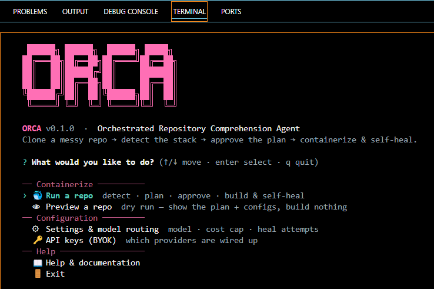
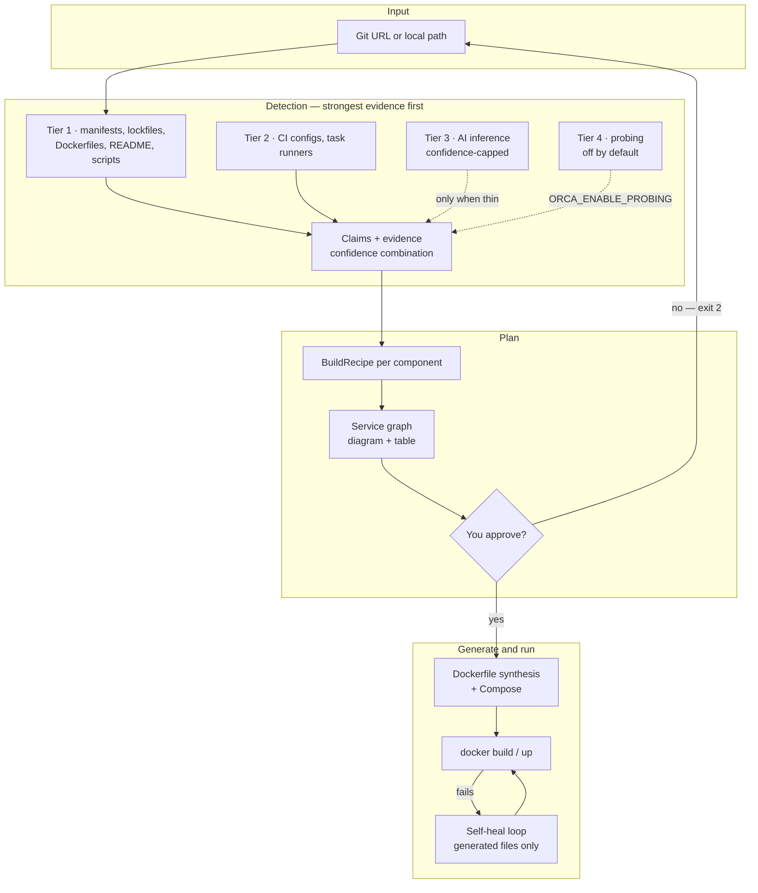
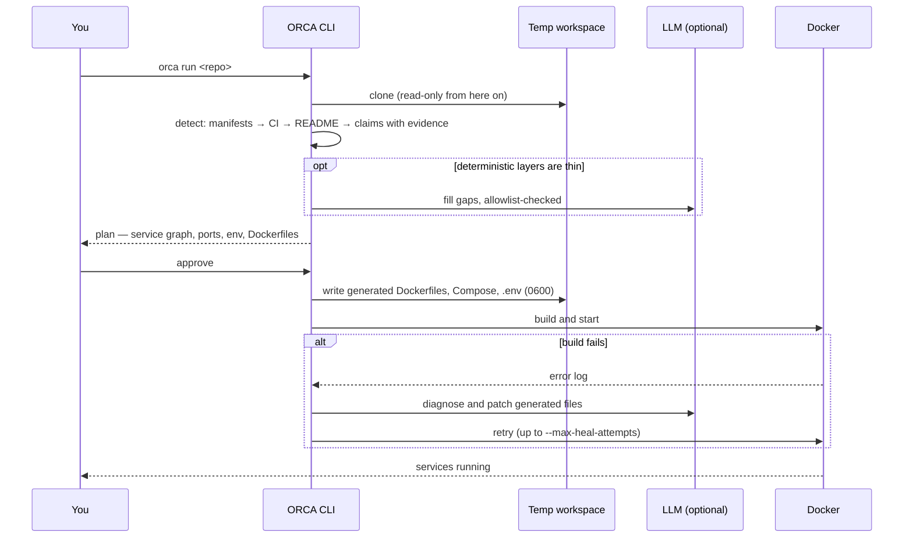

# ORCA

**Orchestrated Repository Comprehension Agent — a CLI that takes a repo you've never seen before and gets it running in Docker, and shows you the evidence for every conclusion.**

[](https://www.npmjs.com/package/orca-agent-cli)
[](.github/workflows/ci.yml)
[](package.json)
[](tsconfig.json)
[](docs/supported-stacks.md)
[](LICENSE)

You've cloned somebody's project and want to run it. There's no Dockerfile, the
README stops after `npm install`, and nobody wrote down which environment
variables matter or which port the API expects. ORCA does that reading for you:
it works out what the project is, writes the Docker and Compose files, shows you
the plan, and starts everything once you approve.

Every conclusion carries a confidence score and the evidence behind it, so when
ORCA says a service listens on 8000 you can see whether it read that from a
Dockerfile, a source file, or a guess.

<p align="center">
  
</p>

---

## Contents

| Section | |
|---|---|
| [What it does](#what-it-does) | The capability surface, by area |
| [Architecture](#architecture) | Detect, plan, approve, generate, build, heal |
| [How a repo travels](#how-a-repo-travels) | From a URL to running containers |
| [Quick start](#quick-start) | Install, dry run, build |
| [Commands and settings](#commands-and-settings) | Flags, environment, exit codes |
| [Project status](#project-status) | Every phase, and what CI proves |
| [Design decisions](#design-decisions) | Safety and the tradeoffs, and why |
| [Repository layout](#repository-layout) | Where things live |
| [Documentation](#documentation) | Which file answers which question |
| [Team](#team) | Who built it |

---

## What it does

| Area | Capabilities |
|---|---|
| **Detection** | Layered evidence ladder: manifests and lockfiles, then CI configs, Makefiles and README commands, then confidence-capped AI inference |
| **Recipes** | 56 build recipes across Node, Python, PHP, Ruby, Go, Rust, JVM and .NET — adding one is a data change, not new code |
| **Monorepos** | Three services in one repo become three containers; pnpm/turbo workspace globs and nested components are scoped correctly |
| **Dependencies** | Postgres, MongoDB and Redis detected from dependencies and wired into Compose with health checks |
| **CI recovery** | GitHub Actions, GitLab CI, Azure Pipelines and CircleCI parsed into ranked build and run commands |
| **Generation** | Multi-stage Dockerfiles synthesised from any recipe (compiled → slim runtime, interpreted → single stage) plus a Compose file |
| **Self-heal** | A failed build is diagnosed, patched and retried, editing only files ORCA generated; learned overrides replay next run |
| **Probing** | Optional: run the planned container locked down and read what actually happened |
| **Interfaces** | Interactive CLI menu, scriptable `orca run`, and a VS Code extension over the same core |

### What it can run

| Ecosystem | Covered |
| :-- | :-- |
| Node | react, express, next, nest, angular, vite, fastify, koa, hapi, hono, remix, nuxt, sveltekit, astro, adonis |
| Python | django, fastapi, flask, litestar, starlette, quart, sanic, bottle, streamlit — uv, poetry or pip, by lockfile |
| PHP | composer, laravel, symfony |
| Ruby | bundler, rails, sinatra |
| Go | go modules, built to a distroless image |
| Rust | cargo |
| JVM | maven, gradle |
| .NET | dotnet sdk |

A Node or Python repo with a manifest and a start script gets a working
container even when its framework has no recipe.

---

## Architecture



AI inference is capped so it can never outrank something ORCA read directly
from a file. If the deterministic layers already explain the project, no API
call happens at all. Details: [docs/architecture.md](docs/architecture.md).

---

## How a repo travels



Nothing touches your disk before you approve. Your repo is never modified.

---

## Quick start

> Working on ORCA itself? See [CONTRIBUTING.md](CONTRIBUTING.md). This is the user
> path.

```bash
# 1 — install
npm install -g orca-agent-cli

# 2 — the interactive menu
orca

# 3 — the safe first run: plan and print configs, write nothing, build nothing
orca run https://github.com/someone/their-project --dry-run

# 4 — when the plan looks right, build and start it
orca run https://github.com/someone/their-project
orca run .                                   # local paths work too
```

Node 22.12 or newer, and Docker if you want ORCA to build and start things. A dry
run needs neither Docker nor an API key. Without a key ORCA falls back to its
deterministic templates and the run still completes; with one it can fill gaps
and repair failed builds:

```bash
export QWEN_API_KEY=...        # primary
export ANTHROPIC_API_KEY=...   # automatic fallback
```

Keys are read from the environment only — there is no flag, so they never land
in your shell history. Sample projects that actually run live in
[`examples/`](examples/README.md).

---

## Commands and settings

| Flag | What it does |
| :-- | :-- |
| `--dry-run` | Work out the plan and print the configs. Writes nothing, builds nothing |
| `--auto-approve` | Skip the approval prompt. Use this in CI |
| `--model <id>` | Pick a model. `claude*` routes to Anthropic, `qwen*` to Qwen |
| `--cost-cap <usd>` | Hard ceiling on what the run may spend on LLM calls |
| `--max-heal-attempts <n>` | Repair attempts before giving up. Defaults to 3 |
| `--verbose` | Verbose debug logging |

Settings resolve flag first, then `ORCA_*` environment variables, then the
default. Logs go to stderr and the plan to stdout. Exit codes: `0` success, `2`
plan rejected at the approval gate, `1` everything else.

### Probing (off by default)

Probing is the only part of ORCA that executes code from the repo, so it runs
only with `ORCA_ENABLE_PROBING=true`, and the approval gate tells you it is on.

| Variable | Default | What it controls |
| :-- | :-- | :-- |
| `ORCA_ENABLE_PROBING` | `false` | Whether probing runs at all |
| `ORCA_PROBE_NETWORK` | `none` | Network for the probe container |
| `ORCA_PROBE_READONLY` | `true` | Read-only root filesystem |
| `ORCA_PROBE_MEMORY` | `512m` | Memory cap |
| `ORCA_PROBE_CPUS` | `1` | CPU cap |
| `ORCA_PROBE_PIDS_LIMIT` | `256` | Process cap, the fork-bomb guard |
| `ORCA_PROBE_TIMEOUT_MS` | `60000` | Wall clock per Docker call |
| `ORCA_PROBE_SETTLE_MS` | `3000` | Settle time before reading state |

Capabilities are dropped, privilege escalation is blocked, and **no host path is
mounted at all**. Loosen the network or read-only defaults only for a repo you
trust; with a writable root the container's own layer is bounded by your disk.

---

## Project status

**Version 0.3.0, published to npm as `orca-agent-cli`.** Every phase of the universal-understanding plan is complete,
every ecosystem in the coverage table has a recipe, and the "free to pick up"
list in [CONTRIBUTING.md](CONTRIBUTING.md#roadmap) is green.

| Phase | Delivers | Status |
|---|---|:---:|
| A — Foundation | Evidence model (`Claim`/`Evidence`/`Detector`), confidence combination, `BuildRecipe` as data | ✅ |
| B — Widen detection | Runtime detectors and recipes per ecosystem, framework signature table, open runtime taxonomy | ✅ |
| C — Repo & CI analysis | Actions / task-runner recovery, existing-Dockerfile detection, cross-tier confidence | ✅ |
| D — AI inference | LLM gap-filler when the deterministic ladder is thin, confidence-capped, reasoning trail | ✅ |
| E — Docker synthesis | Multi-stage Dockerfiles from any recipe; one renderer for seed and ecosystem stacks | ✅ |
| F — Recipe-aware self-heal | Heal loop gets recipe context; learned overrides persisted per repo signature | ✅ |
| G — Dynamic probing | Tier-4 prober behind a security contract, locked-down sandbox | ✅ |

### What CI proves on every push

| Step | Proves |
|---|---|
| Build | The CLI compiles and every workspace, including the extension, builds |
| Lint · format | ESLint and Prettier are clean |
| Test | The vitest suite passes, fully hermetic: no keys, no Docker, no network |
| Dry runs | `orca run` plans the MERN sample and a React/Express fixture end to end |
| Package | The VS Code extension packages |

---

## Design decisions

**Evidence before inference.** Detection runs strongest-evidence first, and AI
is confidence-capped so it cannot outrank anything read from a file. Most repos
are planned with zero API calls.

**Approve before anything is written.** The plan is rendered as a diagram and a
table, and ORCA waits. `--dry-run` is the default way to start.

**Safety in code, not in prompts.** The cloned repo is read-only. The repair loop
can only edit files ORCA created. Base images, build commands and file paths an
LLM proposes are checked against an allowlist before they reach a Dockerfile.
Generated `.env` files are written `0600` ([SECURITY.md](SECURITY.md)).

**Recipes are data.** A new framework or package manager is a table entry, not a
new code path, which is how three seed stacks grew to 56 recipes.

**Execution is opt-in.** Probing settles questions static analysis can only
guess at, but it is the one path that runs repo code, so it is off by default and
locked down when on. An approved build still runs the project's own Dockerfile
instructions — read the plan.

---

## Repository layout

```
.
├── src/
│   ├── detect/        detectors, framework signatures, CI parsers, ports, roles
│   ├── model/         Claim / Evidence / BuildRecipe, confidence combination
│   ├── plan/          service graph and the approval view
│   ├── generate/      Dockerfile synthesis and Compose rendering
│   ├── build/         Docker runner, self-heal loop, learned overrides
│   ├── probe/         the opt-in, locked-down tier-4 sandbox
│   ├── ai/            providers, router, prompts, schema-validated outputs
│   ├── cli/           interactive menu and commands
│   └── core/          the pipeline
├── vscode-extension/  editor UI over the same core
├── examples/          runnable samples: MERN, Django + Postgres, Go, Rust, JVM, .NET, PHP, Ruby
├── tests/             vitest suite and repo fixtures
└── docs/              architecture, supported stacks, the detection plan, demo
```

---

## Documentation

| Question | File |
|---|---|
| *How does the pipeline fit together?* | [docs/architecture.md](docs/architecture.md) |
| *Which stacks are supported?* | [docs/supported-stacks.md](docs/supported-stacks.md) |
| *Why is detection built this way?* | [docs/universal-understanding-plan.md](docs/universal-understanding-plan.md) |
| *What is safe to run on someone else's code?* | [SECURITY.md](SECURITY.md) |
| *Show me it working* | [docs/demo.md](docs/demo.md) · [examples/README.md](examples/README.md) |
| *How do I develop on it, and what is left?* | [CONTRIBUTING.md](CONTRIBUTING.md) |
| *How does the editor integration work?* | [vscode-extension/](vscode-extension/) |

---

## Team

| Member | Focus |
|---|---|
| **Vivian Sobers** | Detection engine — evidence model, detectors, framework signatures, recipes |
| **Guru R Bharadwaj** | AI layer and providers, build and self-heal, probing, CLI, VS Code extension |
| **Diya R Gowda** | Detectors and ecosystem recipes |
| **Harsha Kamaraj** | Detectors |

---

## License

[MIT](LICENSE).
